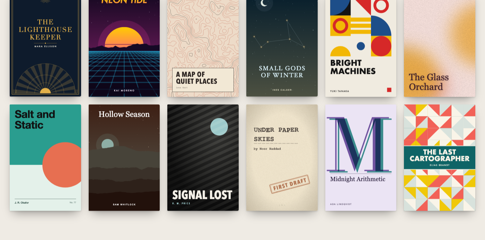

# Book Cover Generator

[](https://github.com/otsirh/book-cover-generator/actions/workflows/ci.yml)
[](https://www.npmjs.com/package/book-cover-generator)
[](https://covers.otsirh.dev)


[](https://scorecard.dev/viewer/?uri=github.com/otsirh/book-cover-generator)
[](https://www.bestpractices.dev/projects/16646)
[](LICENSE)

Generate book covers from a **title** and an **author**. 39 styles, 28 palettes or your own colours, a seeded randomizer, any size, and export to **SVG, PNG, JPEG or WebP**. The library has no dependencies and ships TypeScript types. It's written as plain ES modules, so it runs in the browser, Node, Deno and Bun.

**[▶ Open the generator](https://covers.otsirh.dev)** · [See every style](https://covers.otsirh.dev/gallery/)



## Features

- **39 styles in six families.**
  - Typographic: Big Type, Minimal, Big Letter, Swiss.
  - Genre: Thriller, Botanical, Noir, Blueprint, Hollow (horror), Ribbon (romance), Crest (fantasy), Storybook (children's), Big Idea (non-fiction).
  - Vintage: Art Deco, Classic Paperback, Engraved, Sunburst, Typewriter.
  - Scenic: Landscape, Retro Sun, Silhouette, Constellation, Orbit, Waves, Aurora, Bookshelf.
  - Geometric: Bauhaus, Split, Blocks, Concentric, Stripes.
  - Pattern: Paper Cut, Halftone, Topographic, Flow Field, Low Poly, Mosaic, Memphis, Pixel.
- **28 palettes** (15 light, 13 dark), or pass your own. Every style adapts to light and dark palettes.
- **Typography that responds to the title.** Short titles are set large, a leading "The" (or another article of three letters or more) becomes a small line above the title, and some styles stack the words edge to edge. Long titles wrap with balanced lines and shrink to fit. Author names stay readable at thumbnail size. Accents, emoji, Chinese, Japanese and Thai are handled.
- **Subtitle or tagline**, and an optional **paper texture**.
- **Randomizer.** Every random choice comes from a seed, so the same seed always gives the same cover. If you don't pass a seed, it is derived from the title and author.
- **Any size.** 2:3 paperback, 5:8 eBook, 1:1 audiobook, or any width × height from 50 to 10,000 px with an aspect ratio between 1:3 and 3:1, such as Kindle's 1600 × 2560 or a print trim size at 300 dpi.
- **Export.** Download SVG, PNG, JPEG or WebP. PNG and JPEG files record 300 dpi, so print software sizes them right. Copy the image or the SVG, or share it from a phone.
- **A paperback for print.** The whole cover of a printed book, back, spine and front, as the PDF Amazon KDP takes: sized from the trim and the page count, with bleed, the back cover's text, and room for the barcode.

## The web app

On [covers.otsirh.dev](https://covers.otsirh.dev) you type a title and author (press Enter in the title to break its line where you want), and if you like a subtitle, a series line ("Book Two of the Ember Cycle"), a credit ("Translated by…") and a badge ("Winner of the Hugo Award", set as a seal in a corner clear of the text). Then you choose:

- **a style**, from a rail that previews your book in all 39 styles (its Genre menu shows only those that suit a genre, and Randomize then stays in it). Fifteen styles let you pin a choice the variation otherwise makes, such as Silhouette's city or forest, or where Aurora puts the title;
- **title type**: any of the nine fonts instead of the style's, and the title in capitals or as typed. It stays when you change style, so the rail shows every style in your type;
- **a palette**, from swatches that show the background, text colour and accents, or **Custom** for your own five colours (it starts from the palette on the cover and shows the text contrast);
- **a variation**, the seed behind the artwork: the strip under the preview shows six others to click;
- **a format**: paperback, eBook, square, or **Custom** for any size in pixels, typed in or picked from common sizes (Kindle, print trim sizes at 300 dpi, audiobook, social posts).

**Store size** shrinks the preview to the size a store lists covers at, to check the title still reads. **Randomize** reshuffles everything, except what you've locked. Undo and redo step back and forth through your designs, and so do the browser's Back and Forward buttons. **Copy link** shares the exact design, because the URL holds every setting, and **Copy image link** gives the [HTTP API](#http-api) URL that draws it, to put in any page. The export panel tells you which size suits Kindle, print or audiobook covers.

**Mockup** shows and downloads the cover as a 3D book, a flat shot, on an e-reader, or on a social card (a 1200 × 630 link preview, a square post or a story, with a line such as "Out now").

**Many covers** takes a list of books (one per line as `Title | Author | Subtitle`, or a CSV with a title column) and makes them all with the design you have, as PNG or SVG in one ZIP. With a fixed variation they share one look, as a series does; switch on "A different palette for each" for a set in several colours.

**Paperback for print** makes the whole cover of a printed paperback from the design: the back with your headline, back cover text and imprint (and the barcode's box left clear), the spine with the title and author, and the front. Choose the trim size, the page count and the paper, and it sizes everything as Amazon KDP asks: an eighth of an inch of bleed, a spine as wide as the pages are thick (and blank under 80 pages, as KDP requires), the front's art carried into the bleed. **Download print PDF** saves the file to upload: one page at 300 dpi, its trim marked. The back and spine take any colour of the palette; the settings stay in your browser for next time.

**Keep** saves a design to a tray under the preview, together with the cover as it was drawn, so a later version of the app can't change it. **Download all** saves every kept design as a PNG in one ZIP file. **Export** saves the kept designs to a file, and **Import** adds them in another browser.

The app works offline once it has loaded.

Keyboard shortcuts:

- `R` randomizes.
- `←` and `→` step through styles.
- `[` and `]` step through palettes.
- `Z` undoes and `Shift+Z` redoes.

The single-key shortcuts can be turned off under the controls (for example with speech input).

## HTTP API

The site draws covers from a URL too, so a page can show one with nothing installed:

```html

```

- `GET /api/cover.svg` answers with the cover as SVG.
- `GET /api/mockup.svg` answers with a [mockup](#mockups) of it. Add `kind` (`book`, `flat`, `ereader`, `card`, `square`, `story`), `text` for the line on a card, square or story, and `background`.
- `GET /api/cover.png` and `GET /api/mockup.png` answer with the same as PNG, for places that don't take SVG (email, chat, social posts): a cover up to 600,000 pixels (600 × 900), a mockup up to 2.1 million (a 1080 × 1920 story; a flat or e-reader shot, whose shadow costs more, 1.3 million). A larger one is drawn smaller to fit; `scale` (above 0, up to 4) asks for a size, refused if it won't fit. Larger PNGs come from the app, which draws them in your browser. The server draws them with [open fonts](public/fonts/README.md) and lays the text out in their widths; they have Latin, Greek and Cyrillic letters, so a cover in another script (Chinese, Japanese, Arabic…) gets a `422`: ask for its SVG.

The query takes the options' own names (`title`, `author`, `subtitle`, `series`, `credit`, `badge`, `style`, `palette`, `seed`, `genre`, `font`, `lang`, `width`, `height`) and the app's link parameters, so the part of an app link after `#` draws the same design (the server measures text with the widths of the fonts as macOS draws them, so on another system a line can break a little differently from the app's preview):

| parameter             | value                                                                                          |
| --------------------- | ---------------------------------------------------------------------------------------------- |
| `format`              | `paperback`, `ebook`, `square`, or a size in px such as `1600x2560`                            |
| `case`                | the title `upper`, or `normal` (as typed)                                                      |
| `texture`             | `1` (on) or `0` (off)                                                                          |
| `variant`             | pinned choices as `name.value`, joined by `-`: `field.pale-emblem.sun`                         |
| `palette`             | a palette id, or your own colours as `custom-0b132b-f8f9fa-ff6b6b` (background, text, accents) |
| `bg`, `ink`, `accent` | your own colours, as hex (the `#` is optional; accents separated by commas)                    |

A title breaks its line at `%0A`. A design's link from the app (Copy link: `https://covers.otsirh.dev/?title=…`) shows that design in link previews, as a social card drawn by `/api/mockup.png`. Anyone may embed the answers (CORS and `Cross-Origin-Resource-Policy` allow it), and the headers `X-Cover-Style`, `X-Cover-Palette` and `X-Cover-Version` say what was drawn. The same URL always draws the same cover in a version of the library, so answers are cached for a day. Options the library rejects get a `400` with the reason as plain text.

## On any page: `<book-cover>`

One script, then a cover wherever you write the element:

```html
<script type="module" src="https://covers.otsirh.dev/src/element.js"></script>

<book-cover cover-title="Dune" author="Frank Herbert" cover-style="retro" seed="1"></book-cover>
```

Its attributes are the app's link parameters, except the title and the style, which are `cover-title` and `cover-style` (`title` and `style` are HTML's own): `cover-title`, `author`, `subtitle`, `series`, `credit`, `badge`, `cover-style`, `genre`, `palette`, `seed`, `format`, `font`, `case`, `variant`, `texture` (present: on) and `lang` (the language of the text, such as `zh-Hant`). Styles, palettes and fonts may be named as the app's menus name them. With `loading="lazy"`, as on an image, a cover draws only once it comes near the viewport (a page of many covers loads faster); until then it holds the cover's shape and is named for screen readers, and attributes changed meanwhile apply when it draws. The cover is 240 px wide unless you style the element's `width`; it draws again when an attribute changes, and fires `cover` (with the cover) or `cover-error` (with what's wrong). It is drawn in the page, measuring the text with the fonts installed there, and shown as an image, so a page with Trusted Types can show it (its CSP must allow `data:` images). An image can't use the page's web fonts: if the page loads one that a cover's font stack names (such as EB Garamond or Oswald), the text is measured in it but drawn in the system's font, and may fit less well. From npm: `import 'book-cover-generator/element'`.

## From an AI assistant (MCP)

Book Cover Generator is a [Model Context Protocol](https://modelcontextprotocol.io) server, so an assistant such as Claude can make covers for you: "a cover for my horror novel _The Hollow Night_, in red". It answers with a link to the image and one that opens the cover in the app to change and download.

Add it to Claude Code:

```sh
claude mcp add book-covers -- npx -y book-cover-generator --mcp
# or, with nothing installed, the hosted server:
claude mcp add --transport http book-covers https://covers.otsirh.dev/mcp
```

Or to any client that takes a JSON configuration (Claude Desktop, Cursor and others):

```json
{
  "mcpServers": {
    "book-covers": { "command": "npx", "args": ["-y", "book-cover-generator", "--mcp"] }
  }
}
```

The tools: `create_cover` (a title, and any of author, subtitle, style, genre, palette or your own colours, seed, format, font, pins), `create_mockup` (the same, as a 3D book, on an e-reader or on a social card), `list_styles` and `list_palettes`. Run locally, `create_cover` can also save the SVG to a file (`output`).

## Library usage

### Browser (no install)

```html
<script type="module">
  import { generateCover } from 'https://cdn.jsdelivr.net/npm/book-cover-generator@1/src/index.js';

  document.body.innerHTML = generateCover({
    title: 'The Lighthouse Keeper',
    author: 'Mara Ellison',
    style: 'artdeco',
    palette: 'midnight',
  });
</script>
```

`@1` gives you the latest 1.x release. Pin an exact version (such as `@1.1.0`) if you need the artwork to never change.

### Node, Deno, Bun and bundlers

```sh
npm install book-cover-generator
```

```js
import { createCover } from 'book-cover-generator';
import { writeFileSync } from 'node:fs';

const { svg, style, palette, seed } = createCover({
  title: 'Neon Tide',
  author: 'Kai Moreno',
  style: 'random', // or a style id, see `styles`
  seed: 42, // same seed, same cover
  width: 1600,
  height: 2560,
});
writeFileSync('cover.svg', svg);
```

In Deno, import `npm:book-cover-generator`; in Bun, `bun add book-cover-generator`. CI checks that Node, Deno and Bun draw the same covers byte for byte.

### CLI

```sh
npx book-cover-generator "The Lighthouse Keeper" "Mara Ellison" --style artdeco -o cover.svg
npx book-cover-generator --list   # all styles and palettes
```

```sh
# your own colours (the # is optional), as an eBook 1600 px wide
npx book-cover-generator "Bright Machines" --bg 0b132b --ink f8f9fa --accent ff6b6b,4ecdc4 --format ebook --width 1600 -o cover.svg
# any size, and the choices as JSON (with the SVG, when there is no -o)
npx book-cover-generator "Neon Tide" --size 1800x2700 --json
# a cover for every book in a list (CSV with a header row, JSON lines, or "Title | Author" lines), one look for all
npx book-cover-generator --batch books.csv --style minimal --seed series --out-dir covers
# twelve variations to choose from: ideas/cover-1.svg … ideas/cover-12.svg (seeds 1 to 12)
npx book-cover-generator "Salt and Static" --count 12 -o ideas/cover.svg
# a paperback's whole cover for print (back, spine and front), 6 × 9 in with 320 pages on cream paper
npx book-cover-generator "The Lighthouse Keeper" "Mara Ellison" -s artdeco --print 6x9 --pages 320 --paper cream \
  --hook "Some lights are kept burning." --blurb-file blurb.txt -o paperback.svg
```

Options: `-s/--style`, `-p/--palette`, `--bg`, `--ink`, `--accent`, `--subtitle`, `--texture`, `--seed`, `--format` (`paperback`, `ebook` or `square`), `--width`, `--height`, `--size`, `--genre`, `--lang`, `--series`, `--credit`, `--badge`, `--font`, `--case upper|normal`, `--variant name=value` (`--list` shows each style's), `-o/--out`, `--count`, `--batch <file|->`, `--out-dir`, `--print <trim>` with `--pages`, `--paper`, `--hook`, `--blurb`, `--blurb-file` and `--imprint`, `--json`, `--list`, `--help`. A print cover is an SVG at 96 px to the inch: the app makes the PDF, or any SVG converter does (`rsvg-convert -f pdf`).

## API

### `generateCover(options) → string`

Returns the SVG markup.

### `createCover(options) → { svg, body, style, palette, colors, seed, width, height, lang, variants, title, author }`

Same as `generateCover`, but also tells you which style and palette were chosen. This is useful when either one was random. `body` is the markup inside the outer `<svg>`, for nesting the cover in a larger SVG (its ids are unique to the cover, so several can share a document).

| option      | type               | default              | notes                                             |
| ----------- | ------------------ | -------------------- | ------------------------------------------------- |
| `title`     | `string`           | `'Untitled'`         | a line break (`\n`) breaks the title's line there |
| `author`    | `string`           | `''`                 | optional                                          |
| `subtitle`  | `string`           | `''`                 | optional subtitle or tagline                      |
| `series`    | `string`           | `''`                 | a series line above the title                     |
| `credit`    | `string`           | `''`                 | a credit under the subtitle ("Translated by…")    |
| `badge`     | `string`           | `''`                 | a seal in a corner clear of the text              |
| `texture`   | `boolean`          | `false`              | adds a fine film grain (any truthy value)         |
| `style`     | `string`           | `'random'`           | a style id, see `styles`                          |
| `palette`   | `string \| object` | `'random'`           | a palette id, or `{ bg, ink, accents: [...] }`    |
| `seed`      | `string \| number` | the title and author | controls every random choice                      |
| `width`     | `number`           | `600`                | px, 50–10000; aspect ratio 1:3 to 3:1             |
| `height`    | `number`           | `width × 1.5`        | px, 50–10000                                      |
| `lang`      | `string`           | inferred             | language of the text, such as `'ja'`              |
| `variants`  | `object`           | `{}`                 | pin a style's choices: `{ scene: 'forest' }`      |
| `genre`     | `string`           |                      | with a random style, one that suits this genre    |
| `font`      | `string`           | the style's          | the title's font, one of `FONTS`                  |
| `titleCase` | `string`           | the style's          | `'upper'` (capitals) or `'normal'` (as typed)     |

Styles, palettes, genres and fonts may be given by id or by name, in any case: `'artdeco'`, `'Art Deco'` and `'ART DECO'` are the same style, and a book list or a link can name them as the app's menus do.

`lang` is set on the cover so Chinese characters get the right glyphs for the language. Without it, text with kana is marked Japanese and text with Hangul Korean; pass `'zh-Hans'`, `'zh-Hant'` or `'ja'` for text in Chinese characters only.

Titles and subtitles longer than 300 characters (authors: 200) are cut. With `'random'`, the style and palette are picked from the seed, so you get the same result every time for the same seed. Some styles prefer dark or light palettes when they pick one themselves. Invalid options throw an error that says what's wrong.

### Other exports

- `styles`: array of style ids
- `genres`: `[{ id, name }]`, the genres styles suit: `literary`, `thriller`, `horror`, `romance`, `fantasy`, `children`, `nonfiction`
- `listStyles()`: `[{ id, name, description, group, variants, genres }]`. `variants` lists the choices a style lets you pin, as `[{ name, label, values: [{ value, label }] }]`; pin them with `createCover({ variants: { scene: 'forest' } })`, and `createCover` reports the ones it used in `variants`. Names a style lacks are ignored. A value no style offers throws; with a style you name, so does a value that style lacks (a style picked at random takes only the pins it can)
- `palettes`: `[{ id, name, bg, ink, accents, dark? }]`
- `randomSeed()`: a short random seed string
- `pickStyle(options)`: the style id `createCover` would use for these options (resolving `'random'` from the seed), without drawing the cover
- `registerStyle({ id, name, description, group, prefer, render(ctx) })`: add your own style (see below). Replacing a built-in style takes `registerStyle(style, { replace: true })`; `unregisterStyle(id)` removes a style or brings the built-in back
- `registerPalette({ id, name, bg, ink, accents })`: add a palette to use by id, as `palette: 'brand'` (`{ replace: true }` for a built-in id); `unregisterPalette(id)` removes it. Registered styles and palettes can also be picked by `'random'`, so registering one changes what a seed gives
- `parseBookList(text)`: a list of books (CSV with commas, semicolons or tabs and a header row naming a `title` column, JSON lines, or one "Title | Author | Subtitle" per line) as cover options, one per book
- `styleIdFor(name)`: the id of the style a name or id names, in any case (`'Art Deco'` → `'artdeco'`), or `undefined`
- `optionsForBook(book, defaults)`: the options for one of those books over the options every book shares (its own values win; a genre the shared style doesn't suit picks a style that does)
- `noteText(x0, y0, x1, y1)` and `recordText(draw)`: note where a custom style writes its own text (so a badge stays clear of it), and collect what `draw` notes
- `version`: the library's version (artwork for a seed can change between minor versions)
- `sizeLimits` (`{ min: 50, max: 10000, ratio: 3 }`) and `formats` (`paperback`, `ebook` and `square` as `[width, height]` at 600 px wide): the sizes covers can have, and the app's shapes
- `titleBlock`, `authorFit`: the typography the built-in styles use (a title with its lead line and subtitle, and the author line)
- `fitText`, `drawText`, `fitStack`, `drawStack`, `splitLead`, `measureText`, `setTextMeasurer`, `FONTS`: lower-level text helpers (`fitText` can hyphenate one long word with `hyphenate: px`), and `baselineOf`, `textBottom`, `textGroupAttrs`, `markExtent` for styles that draw text themselves
- `strongAccents`, `textColor`, `tintText`, `fitTitleWith`, `textPanel`, `TEXT_CONTRAST`: the colour and layout helpers the built-in styles use (accents that stand out, text colours that stay readable, giving up art for a longer title, a panel for title and author)
- `svgUtils`: the SVG, colour and noise helpers the built-in styles use

### TypeScript

Types are included. `CoverOptions`, `Cover`, `StyleId`, `PaletteId`, `StyleGroup`, `StyleContext`, `CoverStyle`, `TitleBlock` and the rest are exported from the main entry point, and style and palette ids autocomplete.

### Mockups

```js
import { createCover, createMockup } from 'book-cover-generator';

const cover = createCover({ title: 'Neon Tide', author: 'Kai Moreno' });
const { svg, width, height } = createMockup(cover, { kind: 'book' }); // or 'flat', 'ereader'
const card = createMockup(cover, { kind: 'card', text: 'Out now' }); // 1200 × 630; also 'square', 'story'
```

Product shots (`flat`, `book`, `ereader`) follow the cover's size on a light backdrop (`background` to change it); social cards have fixed sizes and take the cover's colours. `mockupKinds` lists them.

### Print: a paperback's whole cover

```js
import { createPrintCover } from 'book-cover-generator';
import { svgToPdf, downloadBlob } from 'book-cover-generator/browser';

const print = createPrintCover(
  { title: 'The Lighthouse Keeper', author: 'Mara Ellison', style: 'artdeco' },
  { trim: '6x9', pages: 320, paper: 'cream', hook: 'Some lights are kept burning.', blurb: 'When the lamp…' },
);
print.inches; // { width: 13.05, height: 9.25, trim: [6, 9], spine: 0.8, bleed: 0.125 }
const pdf = await svgToPdf(print.svg, { bleed: print.inches.bleed, title: 'The Lighthouse Keeper' });
downloadBlob(pdf, 'paperback.pdf'); // one page at 300 dpi, the file to upload to KDP
```

`createPrintCover(cover, print)` lays out the back (the `hook`, the `blurb`'s paragraphs at the largest size from 12 to 8 pt that fits, an `imprint`, and the barcode's 2 × 1.2 in box kept clear), the spine (the title and author, from 80 pages and when they'd be readable) and the front (the cover these options draw at the trim's shape, its edges mirrored into the bleed). Sizes follow Amazon KDP: `trim` by name (`trimSizes`) or `[width, height]` in inches, `paper` (`paperTypes`: white, cream, color, premium-color), `bleed` (0.125 in) and `pageThickness` for another printer's figures, `backColor` and `spineColor` (the cover's background and ink by default), and `guides` to dash the trim, the folds and the barcode's box for a preview. `spineWidth(pages, paper)` gives the spine alone; `printLimits` what KDP takes. `svgToPdf` draws a page too large for one canvas in strips.

### Export helpers (browser)

```js
import { downloadCover, rasterize, copyText, copyImage, zipFiles } from 'book-cover-generator/browser';

await copyText(svg); // copy SVG markup
await copyImage(svg, { scale: 2 }); // copy a PNG (where canCopyImage() is true)
await downloadCover(svg, 'svg', 'my-cover'); // my-cover.svg
await downloadCover(svg, 'png', 'my-cover', { scale: 3, dpi: 300 }); // 1800×2700 PNG that prints at 6 × 9 in
await downloadCover(svg, 'jpeg', 'my-cover', { width: 1600, quality: 0.9 }); // exactly 1600 px wide
const name = await downloadCover(svg, 'webp', 'my-cover'); // 'my-cover.png' where WebP can't be made
const blob = await rasterize(svg, { type: 'image/webp', width: 1600, height: 2560 });
const zip = await zipFiles([
  { name: 'cover.png', data: blob },
  { name: 'cover.svg', data: svg },
]);
```

`setDpi(blob, dpi)` records the pixel density in a PNG or JPEG you made yourself. It and `zipFiles` also work in Node.

### Custom palette

```js
generateCover({
  title: 'Bright Machines',
  palette: { bg: '#0b132b', ink: '#f8f9fa', accents: ['#ff6b6b', '#4ecdc4', '#ffe66d'] },
});
```

### Custom style

`render(ctx)` returns SVG markup without the outer `<svg>` element. `ctx` contains:

- `title`, `author`, `subtitle` (may be empty; a credit follows the subtitle on a line of its own), `series` (set by `titleBlock` above the title)
- `W`, `H`: the size of the cover
- `u`: a scale unit (1 at a short side of 600px)
- `m`: the suggested margin
- `S`: the short side; base text sizes on it so wide covers work
- `rng`: seeded random with `next`, `float`, `int`, `bool`, `pick`, `shuffle`
- `p`: the palette, with `bg`, `ink`, `accents`, plus `paper` (lighter) and `night` (darker)
- `id(name)`: makes ids that are unique per cover, for gradients and filters
- `titleFont`, `titleCase`: the cover's `font` and `titleCase`, or null; `titleBlock` follows them, so a style that sets its title with it gets them for free
- Text drawn with `drawText`, `drawStack` or `titleBlock` is noted, so a badge stays clear of it; a style that writes its own text elements can call `noteText(x0, y0, x1, y1)`
- `choose(name, values)`: picks one of `values` as `rng.pick` would, unless the cover pins the variant `name`. Declare what can be pinned in the style's `variants`: `{ mood: { label: 'Mood', values: { calm: 'Calm', loud: 'Loud' } } }`

```js
import { registerStyle, titleBlock, authorFit, drawText, FONTS } from 'book-cover-generator';

registerStyle({
  id: 'plain',
  name: 'Plain',
  group: 'Typographic',
  render(c) {
    const title = titleBlock(c, {
      font: FONTS.serif,
      maxWidth: c.W - c.m * 2,
      maxHeight: c.H * 0.5,
      maxSize: c.S * 0.2,
    });
    const author = authorFit(c);
    return (
      `<rect width="${c.W}" height="${c.H}" fill="${c.p.bg}"/>` +
      title.draw({ x: c.m, y: c.m, fill: c.p.ink }) +
      drawText(author, { x: c.m, y: c.H - c.m - author.height, fill: c.p.ink })
    );
  },
});
```

## Notes

- **Fonts.** Covers only use system font stacks (Georgia, Helvetica, Futura, Didot, Impact, Courier and others), each with close matches on Windows, Android and Linux. This is because an SVG drawn into a canvas for PNG/JPEG export can't load web fonts. In the browser, text is measured with a canvas, so it fits exactly. In Node (and the CLI and HTTP API), the built-in fonts are measured from their characters' widths as macOS draws them, so text fits much as it does in the app; fonts of your own are estimated. Plug in a real font engine with `setTextMeasurer` if you need exact fits there.
- **Deterministic.** The same options always give the same artwork. In Node the SVG is identical every time. In the browser, text is measured with the fonts installed on that computer, so line breaks can differ slightly between machines. Registering a custom style changes which style `style: 'random'` picks for a given seed.
- **Versioning.** Artwork for a given seed can change in minor releases (a style gets better). Pin an exact version if you need byte-identical covers forever.
- **Browser support.** Current Chrome, Edge, Firefox and Safari. Every release is tested in Chromium, Firefox and WebKit, including PNG and JPEG export.

## Development

```sh
npm ci                     # install dev tooling (the library itself has no dependencies)
npx playwright install     # browsers for the end-to-end tests
npm run dev                # http://127.0.0.1:4173
```

| script                  | what it does                                                      |
| ----------------------- | ----------------------------------------------------------------- |
| `npm run check`         | lint, format, type and package checks, unit tests and fuzzing     |
| `npm test`              | unit tests (`node --test`)                                        |
| `npm run test:coverage` | unit tests with coverage thresholds                               |
| `npm run test:fuzz`     | property-based fuzzing (fast-check); `FUZZ_RUNS=20` for more      |
| `npm run test:e2e`      | browser tests in Chromium, Firefox, WebKit and mobile Chrome      |
| `npm run format`        | format everything with Prettier                                   |
| `npm run assets`        | regenerate the app icons, the social preview and the README image |
| `npm run deploy`        | run every check, then build and deploy to Cloudflare (`wrangler`) |

Open `examples/contact-sheet.html?palettes=noir,mint&seeds=a,b` on the dev server to see many covers at once (also `styles`, `titles`, `subtitle`, `w`, `h`, `cols` and `texture=1`).

### Project layout

```
src/            the library (plain ES modules + .d.ts types)
  styles/       the 39 styles, in a file per family
bin/            the CLI
site/           the web app (index.html is at the root)
public/         files served at the site root: headers, 404, icons, manifest, service worker
test/           unit tests (node --test)
test-d/         type tests (tsc)
e2e/            browser tests (Playwright)
scripts/        build, dev server and asset generation
worker/         the HTTP API (the site's Worker)
```

The site is a [Cloudflare Workers](https://developers.cloudflare.com/workers/static-assets/) deployment configured in `wrangler.jsonc`: static assets, with security headers in `public/_headers`, and a Worker (`worker/index.js`) that answers `/api/*`. The dev server answers `/api/*` the same way.

## Contributing

Contributions are welcome. See [CONTRIBUTING.md](CONTRIBUTING.md), and report security issues as described in [SECURITY.md](SECURITY.md). Questions, ideas and covers you've made go in [Discussions](https://github.com/otsirh/book-cover-generator/discussions).

## License

[MIT](LICENSE)
